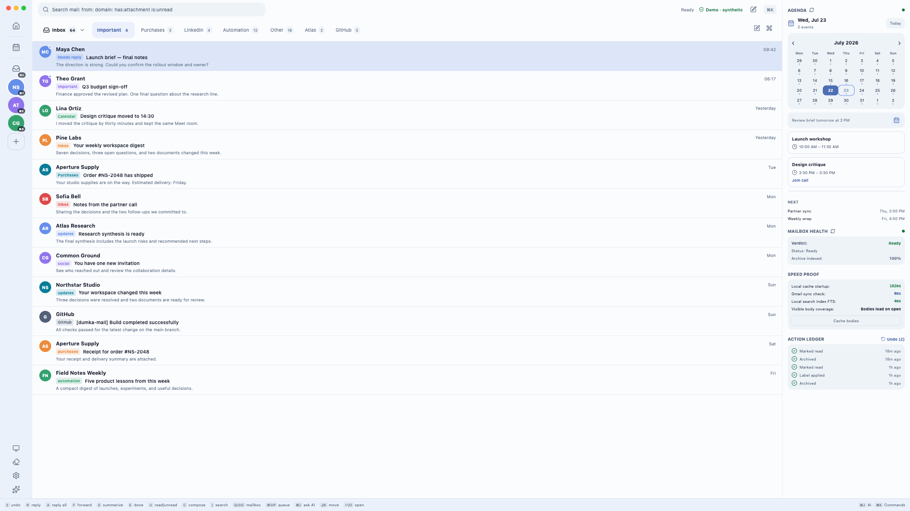
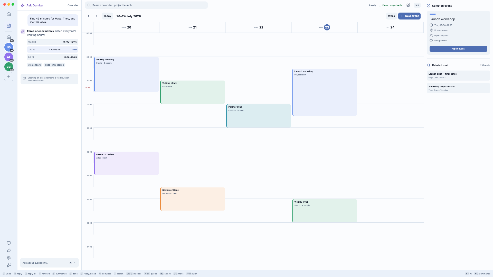

# Dumka Mail

Dumka Mail is a local-first desktop Gmail client built with Electron, React, TypeScript, Tailwind CSS, and SQLite.

The app syncs Gmail metadata and messages into a local SQLite cache, applies mailbox actions optimistically, sorts the inbox into decision sections, and uses optional AI providers to refine that sorting, summarize long threads, and prepare reply drafts. Provider keys and OAuth refresh tokens are stored outside the repository and outside the bundled app.



> The public product images use reserved `.example` addresses and fully synthetic mail, calendar, and account data. They were captured before the decision-sections redesign: the split-inbox tabs, the Today and Privacy & Cleanup screens, and the docked AI panel they show are no longer in the app.

## Status

This project is early alpha software. It is useful for local development and experimentation. Local packages are unsigned by default; signed and notarized macOS distribution builds require Apple Developer credentials.

## Screenshots



The complete asset guide, including the GitHub social preview, is in [docs/media](./docs/media/README.md).

## Features

- Local SQLite mail cache with full-text search and optional opt-in semantic search.
- Gmail OAuth onboarding with OS-backed token storage through macOS Keychain or Electron safeStorage.
- Persistent reconnect guidance for expired, revoked, missing, or under-scoped Google authorization; affected background retries pause until the account is reauthorized.
- Optional incremental Google Calendar and Google Contacts authorization from settings.
- First-class local-first Calendar workspace with per-account and unified multi-calendar views, Google colors and access roles, cache-first Month/Week/Day/Agenda/Quarter/Year layouts, offline search, calendar sets, event templates, secondary time zones, and keyboard navigation.
- Inbox sorted into decision sections: `Reply` / `People`, `Read`, `Event`, `Later`, `Automated`, `Clear`, `Unsubscribe`. A deterministic rule layer works without a model and never sweeps mail from people, security notices, or invitations; a configured model may refine it; a manual move (`V`) wins over both. `⇧E` archives the Clear group and `⇧H` schedules the Later group as one undoable batch. A row of section links above the list (and `[` / `]`) jumps to a section without filtering the list.
- Mailboxes: Inbox, Later (reminders), Waiting (sent without a reply), Drafts, Sent, All mail, Trash, Spam, Muted; Unified Inbox with `⌘0`. Reminders, snooze notifications, and action history.
- Sender rules per account, created only by explicit consent after you repeatedly archive a sender's routine mail: new mail from that sender is archived on arrival and listed under "Handled for you" with Bring back. Two bring-backs switch the rule off. Rules run only when the account allows "Prepare and apply my sender rules".
- Custom category rules and their settings are kept in Settings, but no longer shown as inbox tabs.
- Search operators for sender, labels, attachments, date ranges, and mailbox scope.
- Offline-first mailbox mutations with background reconciliation, including archive, read state, trash, spam, ignore, nested Gmail labels, scheduled sends, rule-driven forwarding, and safe auto-replies.
- Address book sync with contact detail cards, local notes, display-name edits, mailing groups, internal compose handoff, and compose autocomplete.
- Compose, reply, forward, send later, draft mailbox restore, signatures, snippet templates, attachments, insert-link editing, print, and sent mail sync.
- Calendar tools with local and guest free/busy availability suggestions, guest-aware proposed-time insertion, natural-language quick event creation with recurring presets and Google Meet, calendar invite cards with conflict checks, add-to-calendar/RSVP actions, and scheduling-link insertion.
- Full Calendar event management includes all-day events, guests and notification choice, reminders, visibility/free-busy status, Google Meet, recurring instance/series/future-split operations, drag/move, `.ics` preview import/export, native reminders, ETag conflict protection, and a durable offline mutation queue. Mail-derived events keep an explicit source-thread link; mail reminders and Reply Pipeline deadlines appear as visually distinct local tasks.
- Optional AI providers: OpenAI, Anthropic, Gemini, DeepSeek, OpenRouter, and OpenAI-compatible endpoints.
- Local mailbox search plus read-only cached-calendar search/free-slot tools for interactive AI assistant chats, with bounded Operator account scope; opt-in MCP and web-search tools keep secrets in OS-backed credential storage.
- Agent work in place, in the main process: a summary above long threads (with its own provider/model, language and user context in Settings → AI model → Thread summaries; see [summary settings](docs/SUMMARIES.md)) and a reply draft written into the docked editor when you ask for one (`Draft a reply`, `⇧R`). Background work by the model — sorting new mail with a reason on each row, and optionally preparing reply drafts in advance — is off by default and is turned on in Settings → AI model, where its provider and model are chosen from the provider's own list. No model is built into the app: every model in use is one you chose in settings. It never sends, unsubscribes, answers invitations, or deletes on its own. "Ask Dumka" (`⌘J` or the command palette) answers in a floating panel with streamed responses.
- Reply Pipeline / Waiting: inbound reply obligations and outbound follow-ups; pipeline drafts use the normal draft mailbox and are never sent without an explicit send.
- Per-account notification filtering (`People only / All / None`) and actions, monitored mail rules with disabled, shadow, and active modes, unsubscribe through a confirmation sheet, local security snapshots, tracker stripping, and phishing-link warnings.
- Keyboard shortcut discovery overlay, fuzzy command palette matching, virtualized mailbox lists, and accessible thread/draft list semantics.
- Independent appearance controls for the original Classic interface and the softer border-light interface, each compatible with light, dark, and system color modes, existing density options, font scaling, and custom accent colors.
- I18n foundation with persisted interface language settings, an English catalog, and pseudo-locale QA for localized surfaces.
- Built-in auto-update status and checks for configured macOS/Windows update feeds.
- Secure Electron defaults: context isolation, sandboxed renderer, disabled Node integration, and typed preload IPC.

## Requirements

- macOS for the currently tested desktop package. Windows/Linux use Electron safeStorage for local token persistence when OS encryption is available.
- Node.js 22.12 or newer (Node.js 24 is used in CI and the Electron runtime).
- npm 10 or newer.
- A Google OAuth desktop client JSON file with Gmail API access. Calendar and Contacts scopes are requested later from Settings only when those integrations are enabled.

Calendar shortcuts: `⌘⇧C` opens Calendar, `N`/`C` creates an event, `T` returns to today, `/` searches the local event cache, arrow keys navigate, and `1`–`6` switch Day through Year views.

## Setup

Install dependencies:

```bash
npm install
```

Place the Google OAuth client JSON here:

```text
~/.config/dumka-mail/google-oauth-client.json
```

Configure optional AI providers from Settings -> AI Configuration. The app stores provider keys in OS-backed storage when available and keeps non-secret provider settings in a local config file outside the repository.

Configure optional MCP and built-in web-search tools from Settings -> MCP & Search. External tool use is disabled for AI requests by default and must be explicitly enabled for interactive assistant chats. The local mailbox search tool is read-only and sends only bounded local-cache snippets/results to the selected AI provider. When a chat explicitly asks for mailbox actions, the provider may return typed proposals tied to those same-request sources; proposals only enter the local Review Queue and never execute or send mail without approval.

Advanced users can pre-seed AI settings with a dotenv-style file at `~/.config/dumka-mail/ai.env`. The old `openai.env` filename is still read as a legacy fallback.

Semantic-search provider, model, endpoint, dimensions, and index maintenance are configured in Settings -> AI Configuration. Semantic search is disabled by default. When enabled, background indexing only backfills small recent batches; use the Settings index controls to inspect coverage, reindex all cached mail, rebuild the current provider/model/dimension index, cancel an active job, or delete old indexes. Changing provider, model, endpoint, or dimensions creates a separate local index key, so vectors from a previous configuration are not mixed with new query vectors.

Application activity and sync failures can be inspected from Settings -> Logging. The viewer reads structured local SQLite events, supports live severity/source/search filters, and applies configurable time and record-count retention without requiring a log file or Terminal. See [docs/LOGGING.md](docs/LOGGING.md).

Do not commit local OAuth files, provider keys, refresh tokens, SQLite databases, logs, or app exports.

## Productivity workflows

Search supports visual filters and saved queries. Commitments, AI corrections, and attention snoozes are still stored locally but currently have no screen. See [docs/PRODUCTIVITY.md](docs/PRODUCTIVITY.md) for what is reachable and what is stored.

## Development

Run the app in development mode:

```bash
npm run dev
```

Run tests:

```bash
npm test
```

Run the production build and TypeScript check:

```bash
npm run build
```

Build a local macOS app directory:

```bash
npm run package:mac
```

Run signed/notarized macOS release preflight:

```bash
npm run release:preflight:mac
```

See [docs/RELEASE.md](./docs/RELEASE.md) for unsigned local packages, Windows/Linux package commands, and signed/notarized macOS distribution requirements.

Install the locally built app into `/Applications`:

```bash
npm run install-app
```

## Privacy

Dumka Mail has no hosted backend in this repository. Mail data, settings, sync state, drafts, and action history are stored locally on the user's machine. See [docs/PRIVACY.md](./docs/PRIVACY.md) for details.

## Security

Please do not open public issues with secrets, tokens, real email content, or OAuth artifacts. See [SECURITY.md](./SECURITY.md).

## License

MIT. See [LICENSE](./LICENSE).

Dependency versions, security resolution and compatibility checks are recorded in [Dependency maintenance](docs/DEPENDENCIES.md).
